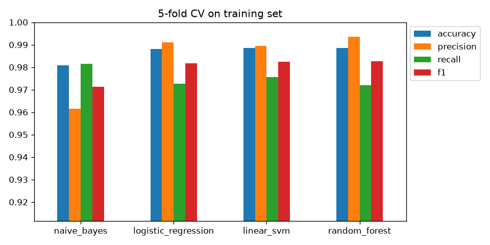

# Judol Comment Detector — Online Gambling Spam Classification


## 📌 Overview
Indonesian YouTube comment sections are flooded with spam promoting online gambling sites
(*judi online* / *judol*), often disguised with fancy Unicode (`𝐒𝐆𝐈𝟖𝟖`, `Ｐｕｌａｕ７７７`, `ᑭᑌᒪᗩᑌᗯIᑎ`)
to dodge keyword filters. This project builds the full lifecycle of a machine learning system that
classifies a comment as **judol** (gambling promotion) or **normal**: data cleaning, modeling,
robustness testing, a REST API, Docker packaging, monitoring, and CI.

This repository is intended for **educational, analytical, and portfolio purposes only**.

## 📊 Results

| Metric | Random split (1,801 test comments) | Unseen gambling sites |
|---|---|---|
| Accuracy | 0.991 | — |
| Precision (judol) | 0.992 | — |
| Recall (judol) | 0.982 | **0.904** |
| F1 (judol) | 0.987 | — |
| ROC-AUC | 0.999 | — |

The second column comes from a **brand holdout** test (`src/robustness.py`): the model is trained without any
comment mentioning a given site and evaluated on that site's spam. It is the more realistic estimate for
brand-new gambling sites.

Model: TF-IDF (word 1–2-grams + char 2–5-grams) + hand-crafted Unicode features → Logistic Regression.
Chosen over Naive Bayes, Linear SVM, and Random Forest via 5-fold CV and the one-standard-error rule.
Grid-search tuning gave no meaningful gain (CV F1 0.9818 → 0.9820), so defaults are kept.



## 🧠 Pipeline
1. **Cleaning**: drop the leaky `predicted_label` column, remove 1,229 duplicate comments *before* splitting
2. **Normalization**: NFKC, homoglyph mapping (Cyrillic/Greek/Cherokee/syllabics), zero-width removal, `k o i s l o t` → `koislot`
3. **Features**: word TF-IDF, character TF-IDF, styled-character ratio, non-Latin letter ratio, digit ratio, brand+number count
4. **Model selection**: stratified 5-fold CV on the training set only, optional grid search
5. **Evaluation**: precision/recall/F1, ROC-AUC, threshold trade-off, error analysis, brand-holdout robustness
6. **Serving**: FastAPI REST API with web UI, Docker image, version metadata in `models/model_info.json`
7. **Monitoring**: privacy-preserving prediction log + drift checks against the training baseline

## 🚀 Quick Start
```bash
python -m venv .venv
.venv\Scripts\activate          # Windows  (macOS/Linux: source .venv/bin/activate)
pip install -r requirements.txt

python -m src.download          # fetch dataset from Kaggle into data/raw/
python -m src.train             # train, evaluate, save model + reports  (--tune for grid search)
python -m src.robustness        # recall on unseen gambling sites
python -m src.predict "gacor parah di 𝐒𝐆𝐈𝟖𝟖" "mobilnya keren bang"
pytest                          # run tests
```

### Serve the model
```bash
uvicorn src.api:app --reload    # http://127.0.0.1:8000 (web UI), /docs (Swagger)
python -m src.monitor           # drift report from logs/predictions.jsonl

# or with Docker (train first so models/ exists)
docker build -t judol-detector .
docker run -p 8000:8000 judol-detector
```

```bash
curl -X POST http://127.0.0.1:8000/predict -H "Content-Type: application/json" \
     -d '{"texts": ["gacor parah di alexis17", "mobilnya keren bang"]}'
```

## 📁 Project Structure
```
├── data/                      # dataset goes in data/raw/ (not committed)
├── notebooks/
│   ├── 01_eda.ipynb           # exploratory data analysis
│   ├── 02_modeling.ipynb      # training, evaluation, thresholds, error analysis
│   └── 03_tuning_robustness_deployment.ipynb
├── src/
│   ├── config.py              # paths & constants
│   ├── download.py            # dataset download
│   ├── preprocessing.py       # cleaning, Unicode normalization, hand-crafted features
│   ├── model.py               # feature pipeline, candidate models, CV, grid search
│   ├── evaluation.py          # metrics, plots, feature importance, error analysis
│   ├── train.py               # end-to-end training script
│   ├── robustness.py          # brand-holdout evaluation
│   ├── predict.py             # classify new comments (CLI)
│   ├── api.py                 # FastAPI service + web UI
│   └── monitor.py             # drift monitoring
├── tests/                     # pytest unit tests (toy data, no dataset needed)
├── .github/workflows/ci.yml   # run tests on every push
├── Dockerfile
├── requirements.txt           # development
├── requirements-api.txt       # serving only (pinned)
├── models/                    # saved model + model_info.json (generated)
└── reports/                   # metrics.json, robustness.json, figures (generated)
```

## 🛠 Tech Stack
Python · Pandas · NumPy · Scikit-learn · Matplotlib / Seaborn · Jupyter · FastAPI · Docker · pytest · GitHub Actions

## 📊 Dataset
[Judionline](https://www.kaggle.com/datasets/yaemico/judionline) by yaemico: 10,230 Indonesian YouTube
comments labeled `1` (gambling promotion) or `0` (normal). See [data/README.md](data/README.md).

> ⚠️ Disclaimer:
> This project does **not** promote gambling. Its purpose is to *detect* gambling spam.
> All analysis is conducted strictly for academic and research purposes.
